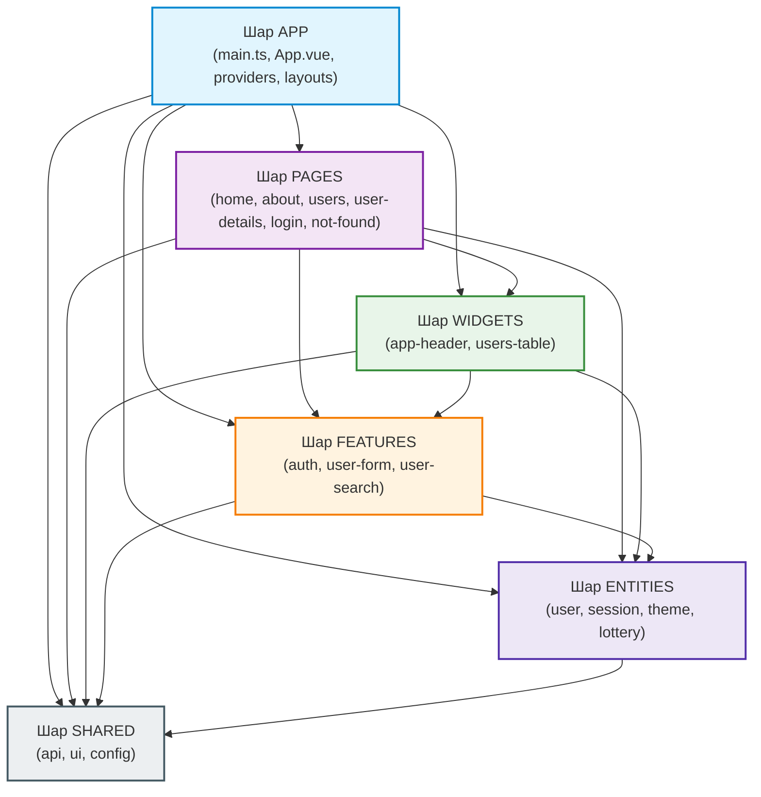

# Лабораторна робота №6: Архітектура Feature-Sliced Design (FSD), Pinia та UI-бібліотека PrimeVue

**Дисципліна:** Інженерія клієнтських веб-систем  
**Стек:** Vue 3 (Composition API, `<script setup>`), TypeScript, Feature-Sliced Design (FSD), Pinia, `pinia-plugin-persistedstate`, PrimeVue (Aura theme), Vue Router 4, VeeValidate 4 + Yup, SCSS, Steiger (FSD Linter), Vite  
**Гілка:** `feature/fsd` (створена від `feature/routing`)  
**Репозиторій проєкту:** `vue-lottery-app`  

---

## 📌 Зміст
1. [Огляд та архітектура FSD](#-архітектура-feature-sliced-design-fsd)
2. [Діаграма залежностей шарів (Mermaid)](#-діаграма-залежностей-шарів)
3. [Рефакторинг патерну Repository](#-рефакторинг-патерну-repository-у-fsd)
4. [Керування станом Pinia та збереження сесії](#-керування-станом-pinia)
5. [UI-бібліотека PrimeVue та обгортки в shared/ui](#-ui-бібліотека-primevue-та-обгортки-в-sharedui)
6. [Перемикання світлої та темної теми](#-перемикач-світлоїтемної-теми)
7. [Лінтер FSD Steiger](#-лінтер-правил-fsd-steiger)
8. [Історія комітів](#-історія-комітів)
9. [Відповіді на контрольні запитання (1–16)](#-відповіді-на-контрольні-запитання)

---

## 🏗️ Архітектура Feature-Sliced Design (FSD)

Методологія **Feature-Sliced Design** організує код застосунку на суворі ієрархічні шари (layers), слайси (slices) та сегменти (segments), гарантуючи односпрямованість залежностей і запобігаючи циклічним імпортам.

```text
src/
├── app/                  # Шар ініціалізації: провайдери роутера, сервісів, UI, стилі, App.vue, main.ts
│   ├── layouts/          # AuthLayout, DefaultLayout
│   ├── providers/        # router (routes, guards), services (IoC-реєстрація), ui (PrimeVue + теми)
│   ├── styles/           # main.scss (Bootstrap SCSS модулі + Dark theme)
│   ├── App.vue
│   └── main.ts
├── pages/                # Слайси сторінок (маршрутів)
│   ├── home/             # Головна сторінка з описом стеку
│   ├── about/            # Про автора
│   ├── users/            # Список користувачів, лотерея, пагінація, пошук
│   ├── user-details/     # Детальний перегляд і вкладене редагування /users/:id/edit
│   ├── login/            # Сторінка авторизації
│   └── not-found/        # 404 сторінка
├── widgets/              # Великі композиційні блоки інтерфейсу
│   ├── app-header/       # Шапка застосунку, навігація, логотип, перемикач теми
│   └── users-table/      # Таблиця користувачів з діями
├── features/             # Бізнес-дії користувача
│   ├── auth/             # LoginForm, LogoutButton
│   ├── user-form/        # UserForm (створення й редагування з VeeValidate)
│   └── user-search/      # SearchBar (пошук із debounce)
├── entities/             # Бізнес-сутності предметної області
│   ├── user/             # User типи, UserService, users.store
│   ├── session/          # Session типи, AuthService, session.store
│   ├── theme/            # ThemeMode, theme.store (світла / темна тема)
│   └── lottery/          # Participant, Winner, WinnersBlock, WinnerBadge
└── shared/               # Перевикористовуваний незалежний код
    ├── api/              # httpClient, інтерфейси Repository, універсальний ServiceProvider
    ├── ui/               # Тонкі обгортки: AppButton, AppInput, AppTable, AppConfirmDialog, AppToast
    └── config/           # Змінні середовища API_URL, BASE_URL
```

---

## 📊 Діаграма залежностей шарів

Модуль може імпортувати лише модулі з шарів, розташованих **суворо нижче** за нього. Імпорти між слайсами одного шару заборонені. Імпорти виконуються виключно через **Public API (`index.ts`)**.



---

## 🔄 Рефакторинг патерну Repository у FSD

У класичній архітектурі `ServiceProvider` імпортував конкретні сервіси `UserService` та `AuthService`.  
За правилами FSD:
* `ServiceProvider` розміщений у `shared/api`.
* `UserService` та `AuthService` розміщені в `entities/user/api` та `entities/session/api`.
* **Шар `shared` НЕ може імпортувати з шару `entities`!**

### Рішення (Inversion of Control):
`ServiceProvider` перетворено на універсальний реєстр фабрик (`Map<string, Factory<T>>`), що не має жодних залежностей на конкретні класи:
```ts
// src/shared/api/service-provider.ts
type Factory<T> = () => T
export class ServiceProvider {
  private static factories = new Map<string, Factory<unknown>>()
  private static instances = new Map<string, unknown>()

  static register<T>(key: string, factory: Factory<T>): void {
    this.factories.set(key, factory)
  }

  static get<T>(key: string): T {
    if (!this.instances.has(key)) {
      const factory = this.factories.get(key)
      if (!factory) throw new Error(`Service "${key}" is not registered`)
      this.instances.set(key, factory())
    }
    return this.instances.get(key) as T
  }
}
```
А реєстрація виконується в шарі `app`, який має доступ до всіх шарів:
```ts
// src/app/providers/services.ts
import { ServiceProvider } from '@/shared/api'
import { UserService } from '@/entities/user'
import { AuthService } from '@/entities/session'

export function registerServices(): void {
  ServiceProvider.register('users', () => new UserService())
  ServiceProvider.register('auth', () => new AuthService())
}
```

---

## ⚡ Керування станом Pinia

Стори реалізовано згідно з концепцією **Setup Stores** (аналог Composition API):
1. **`useSessionStore` (`src/entities/session`)**:
   * Зберігає стан авторизації (`accessToken`, `refreshToken`, `user`, `isLoading`, `error`).
   * Синхронізація сесії з `localStorage`.
   * Підключено плагін `pinia-plugin-persistedstate`.
2. **`useUsersStore` (`src/entities/user`)**:
   * Зберігає реактивний список користувачів, `total`, стан завантаження та помилки.
   * Використовує `ServiceProvider.get<UserService>('users')`.
   * Підтримує CRUD над DummyJSON з імітацією та збереженням локальних змін.
3. **`useThemeStore` (`src/entities/theme`)**:
   * Зберігає активну тему (`'light' | 'dark'`), змінює CSS-клас `.app-dark-theme` на кореневому елементі.

### Порівняння: `pinia-plugin-persistedstate` vs Ручна реалізація

| Критерій | Ручна реалізація (`localStorage.setItem/getItem`) | `pinia-plugin-persistedstate` |
| :--- | :--- | :--- |
| **Код та boilerplate** | Вимагає ручного виклику `localStorage.setItem` у кожній дії та парсингу `JSON.parse` під час ініціалізації. | Декларативний: достатньо додати опцію `persist: true` або `persist: { pick: [...] }`. |
| **Реактивність** | Потрібно вручну синхронізувати ref і сховище при будь-яких мутаціях. | Автоматично слухає `$subscribe` Pinia та серіалізує оновлений стан. |
| **Гнучкість** | Повний контроль над тим, коли і які ключі записуються. | Підтримує вибіркові поля (`pick`), кастомні серіалізатори та різні бекенди збереження (`sessionStorage`, cookies). |
| **Обробка помилок** | Потрібно самостійно огортати виклики в `try/catch` на випадок переповнення квоти або відключеного storage. | Вбудована обробка помилок та міграцій стану. |

---

## 🎨 UI-бібліотека PrimeVue та обгортки в `shared/ui`

Підключено бібліотеку **PrimeVue 4/5** із пресетом теми **Aura** (`app/providers/ui.ts`).
Для дотримання слабкої зв'язності (Decoupling) створено власні компоненти-обгортки в `src/shared/ui`:
* **`AppButton`**: обгортка над PrimeVue `Button` (підтримка `severity`, `outlined`, `size`, `loading`, `variant`).
* **`AppInput`**: обгортка над `InputText` з відображенням помилок валідації VeeValidate та обов'язкових полів.
* **`AppTable`**: обгортка над `DataTable` та `Column` з підтримкою пагінації та слотів.
* **`AppConfirmDialog`**: обгортка над `ConfirmDialog` із сервісом підтвердження видалення користувачів (`useAppConfirm`).
* **`AppToast`**: обгортка над PrimeVue `Toast` для спливаючих сповіщень (`useAppToast`).

---

## 🌓 Перемикач світлої/темної теми

* Кнопка швидкого перемикання додана у віджет `AppHeader`.
* Стан зберігається у `localStorage` під ключем `lottery_theme`.
* Підтримує автоматичне додавання класу `.app-dark-theme` до тегу `<html>`, стилізуючи Bootstrap-компоненти, таблиці, картки та хедер.

---

## 🔍 Лінтер правил FSD (Steiger)

Для автоматичної перевірки архітектурних меж налаштовано **Steiger**:
```bash
npm run lint:fsd
```
Лінтер перевіряє:
* Відсутність обходу Public API (`fsd/no-public-api-sidestep`);
* Дотримання напрямку імпортів між шарами (`fsd/forbidden-imports`);
* Відсутність перехресних імпортів між слайсами одного шару.

---

## 📜 Історія комітів

Відповідно до вимог лабораторної роботи:
1. `chore: add Pinia, UI library, FSD linter`
2. `refactor: introduce FSD folder structure`
3. `refactor: split Repository across FSD layers`
4. `feat: add Pinia stores`
5. `feat: add shared/ui wrappers`
6. `refactor: use wrappers and stores in pages and widgets`
7. `chore: fix FSD lint errors`

---

## ❓ Відповіді на контрольні запитання

#### 1. Що таке Feature-Sliced Design і які проблеми вона вирішує?
Feature-Sliced Design (FSD) — це архітектурна методологія організації коду клієнтських застосунків. Вона вирішує проблеми спагетті-коду, високої зв'язності модулів, циклічних залежностей та складності масштабування застосунку у великих командах.

#### 2. Які шари виділяються у FSD? У якому порядку вони розташовані і чому?
Шари (згори донизу): `app` → `pages` → `widgets` → `features` → `entities` → `shared`. Порядок зумовлений рівнем абстракції та бізнес-значущості: найвищий шар містить глобальну конфігурацію, а найнижчий — загальний інструментарій без бізнес-логіки.

#### 3. Яке головне правило імпортів між шарами? Чи може features імпортувати з widgets?
Головне правило: модуль може імпортувати код ТІЛЬКИ з шарів, що розташовані нижче за нього. Шар `features` НЕ може імпортувати з `widgets`, оскільки `widgets` стоїть вище в ієрархії.

#### 4. Чому слайси одного шару не повинні імпортувати один одного? Як вирішувати ситуацію, коли двом слайсам потрібен спільний код?
Ізоляція слайсів запобігає неявним перехресним залежностям (tight coupling) та циклічним імпортам. Якщо двом слайсам потрібен спільний функціонал, його виносять на шар нижче — в `entities` (якщо є прив'язка до бізнес-сутності) або в `shared` (якщо це утиліта чи абстрактний UI).

#### 5. Що таке слайс і сегмент? Які сегменти використовуються найчастіше?
* **Слайс (Slice)** — поділ шару за предметною або функціональною областю (наприклад, `entities/user`, `features/auth`).
* **Сегмент (Segment)** — поділ слайса за технічним призначенням. Найчастіші: `ui` (компоненти), `model` (типи, стори, стан), `api` (сервіси, репозиторії), `lib` (утиліти), `config` (константи).

#### 6. Що таке Public API слайса і навіщо потрібен index.ts?
Public API — це єдина точка входу слайса (`index.ts`), яка явно реекспортує дозволені назовні інтерфейси, компоненти та стори. Вона інкапсулює внутрішню структуру слайса і захищає від глибоких неконтрольованих імпортів.

#### 7. Чим відрізняються шари entities та features? Наведіть приклади із цієї лабораторної.
* `entities` представляють бізнес-сутність і її дані без прив'язки до конкретної взаємодії з користувачем (наприклад, `entities/user` містить типи користувача та `users.store`).
* `features` відповідають за конкретну дію користувача, що має бізнес-цінність (наприклад, `features/auth` містить форму входу, `features/user-form` — форму редагування).

#### 8. Чому шари app та shared не діляться на слайси?
Шар `app` представляє єдину неподільну ініціалізацію всього застосунку, а шар `shared` містить абстрактний код, що не має відношення до бізнес-доменів, тому поділ на предметні слайси для них не має сенсу.

#### 9. Чому ServiceProvider з лабораторної №5 не можна залишити в shared в початковому вигляді і як це було вирішено?
У вихідному вигляді `ServiceProvider` імпортував класи `UserService` та `AuthService`. Оскільки ці сервіси належать шару `entities`, шар `shared` порушував би головне правило FSD (імпорт знизу-вгору). Проблему вирішено патерном IoC/Registry: `ServiceProvider` став універсальним контейнером фабрик, а самі сервіси реєструються у ньому на рівні шару `app`.

#### 10. Що таке Pinia і чим вона відрізняється від звичайного composable зі спільним ref?
Pinia — офіційна бібліотека управління станом Vue 3. На відміну від простого composable з глобальним ref, Pinia надає: DevTools-інтеграцію (таймлайн, інспекція стану), підтримку SSR, HMR без скидання стану, систему плагінів (наприклад, `pinia-plugin-persistedstate`), деструктуризацію через `storeToRefs`, та суворіший контроль життєвого циклу.

#### 11. Чим відрізняються options stores та setup stores? Для чого потрібна функція storeToRefs?
* **Options Stores** використовують декларативну структуру з полями `state: () => ({})`, `getters: {}`, `actions: {}`.
* **Setup Stores** використовують функцію-фабрику аналогічно до Composition API (`ref` = state, `computed` = getters, `function` = actions).
* `storeToRefs` створює refs для кожної реактивної властивості стору, дозволяючи виконувати деструктуризацію стану та гетерів без втрати реактивності.

#### 12. Чому не можна напряму деструктуризувати state зі Store без storeToRefs?
Стор Pinia є реактивним об'єктом (`reactive`). Звичайна JavaScript-деструктуризація `const { users } = store` копіює поточне значення за посиланням або примітивом, втрачаючи геттери реактивності Vue (Proxy), через що компонент перестає оновлюватися при зміні даних.

#### 13. Чому звертатися до сервісів (репозиторіїв) із компонентів не рекомендується, а доступ краще здійснювати через Store?
Прямий доступ із компонентів до сервісів дублює запити до API, ускладнює синхронізацію однакових даних між різними частинами інтерфейсу та змішує відображення з бізнес-логікою. Стор забезпечує єдине джерело правди (Single Source of Truth), кешування та спільний стан завантаження/помилок.

#### 14. Для чого UI-компоненти бібліотеки обгортають у власні компоненти в shared/ui?
Для зниження залежності від сторонньої бібліотеки (Vendor Lock-in). Якщо бібліотека оновиться з breaking changes або виникне потреба замінити PrimeVue на іншу бібліотеку, зміни торкнуться лише одного файлу в `shared/ui`, а весь інший код застосунку залишиться незмінним.

#### 15. Що таке tree-shaking і як забезпечити підключення лише потрібних компонентів UI-бібліотеки?
Tree-shaking — це процес видалення мертвого або невикористаного коду під час збірки бандлу Rollup/Vite. Для забезпечення tree-shaking імпортують лише конкретно необхідні компоненти з їхніх підшляхів (наприклад, `import Button from 'primevue/button'`), не імпортуючи бібліотеку монолітно.

#### 16. Які переваги й недоліки FSD для невеликого застосунку, як vue-lottery-app?
* **Переваги:** Чітке розуміння призначення кожного файлу, захист від спагетті-імпортів через Public API, легкість супроводу, готовність проєкту до масштабування.
* **Недоліки:** Велика кількість папок та файлів `index.ts`, відчутний overhead на початковому етапі для маленьких додатків, необхідність суворого дотримання конвенцій іменування.
